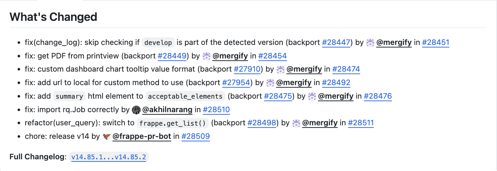
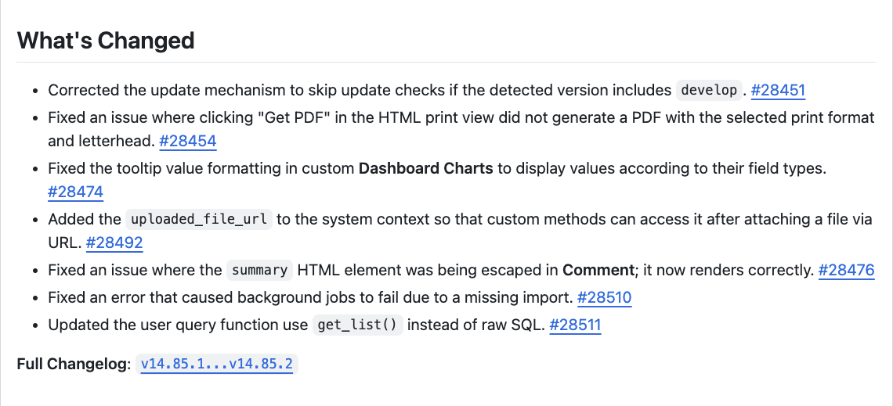

Turn GitHub's auto-generated release notes into human-readable sentences.

Go from this:



To this:



## Features

- **AI-Powered Summaries** - Converts technical PR titles into clear, user-friendly sentences
- **Smart Filtering** - Automatically excludes non-user-facing changes (chore, ci, refactor, test, style)
- **Revert Detection** - Automatically filters out PRs that were reverted within the same release
- **Backport Intelligence** - Reuses summaries from original PRs for backports, maintaining consistency
- **Author & Reviewer Attribution** - Credits human contributors while excluding bots
- **Intelligent Caching** - Stores generated summaries to avoid redundant API calls and reduce costs
- **Grouped Release Notes** - Optional grouping by conventional commit type (Features, Bug Fixes, Performance, etc.) or by area (Accounts, Stock, etc.)
- **Multi-Mode Architecture** - Use as CLI tool, Python library, or REST API backend
- **Rich Context** - Incorporates PR descriptions, linked issues, and code diffs for accurate summaries
- **Interactive Setup** - Guided configuration with validation and migration from legacy formats

> [!NOTE]
> The default prompt is geared towards [ERPNext](https://github.com/frappe/erpnext) and the [Frappe Framework](https://github.com/frappe/frappe). If you want to use this for different projects, set your own `prompt_path` in `config.toml`.

## Installation

```bash
uv tool install pretty-release-notes
```

This puts the `pretty-release-notes` command on your PATH. To run it once without installing, use `uvx pretty-release-notes`. Without [uv](https://docs.astral.sh/uv/), `pip install pretty-release-notes` works as well.

## Configuration

### Interactive Setup (Recommended)

The easiest way to configure the tool is using the interactive setup command:

```bash
pretty-release-notes setup
```

This will:
- Guide you through all configuration options with helpful prompts
- Show sane defaults for each setting
- Create the config file at `~/.pretty-release-notes/config.toml`

**First-time migration from .env?** Use the `--migrate-env` flag:
```bash
pretty-release-notes setup --migrate-env
```
This will read your existing `.env` file and suggest those values as defaults.

### Manual Setup

Alternatively, copy `config.toml.example` to `~/.pretty-release-notes/config.toml` and fill in your credentials:

```bash
# Create config directory
mkdir -p ~/.pretty-release-notes

# Download the example config
curl -o ~/.pretty-release-notes/config.toml https://raw.githubusercontent.com/barredterra/pretty_release_notes/main/config.toml.example

# Edit with your credentials
nano ~/.pretty-release-notes/config.toml
```

### Configuration Format

The configuration file uses TOML format with sections for GitHub credentials, LLM settings, database caching, and filters. The canonical section name is `[llm]`, while the legacy `[openai]` section is still accepted for backward compatibility. Prefer fully qualified `provider:model` values such as `openai:gpt-4.1`; unqualified model names are still accepted and default to OpenAI for backward compatibility. You can also set `reasoning_effort` to `none`, `low`, `medium`, `high`, or `xhigh` for supported models/providers. See [`config.toml.example`](https://github.com/barredterra/pretty_release_notes/blob/main/config.toml.example) for the complete structure and all available options.

You can override the config location using the `--config-path` flag.

## Usage

### CLI

After installation, you can use the CLI in several ways:

```bash
# View all commands
pretty-release-notes --help

# Generate release notes
pretty-release-notes generate erpnext v15.38.4  # using owner from config.toml
pretty-release-notes generate --owner alyf-de banking v0.0.1

# Use a custom config file
pretty-release-notes generate --config-path /path/to/config.toml erpnext v15.38.4

# Specify custom comparison range
pretty-release-notes generate erpnext v15.38.4 --previous-tag v15.38.0

# Override reasoning effort for a single run
pretty-release-notes generate erpnext v15.38.4 --reasoning-effort high
```

Example output:

```markdown
---- Original ----
## What's Changed
* fix: list view and form status not same for purchase order (backport #43690) (backport #43692) by @mergify in https://github.com/frappe/erpnext/pull/43706


**Full Changelog**: https://github.com/frappe/erpnext/compare/v15.38.3...v15.38.4

---- Modified ----
## What's Changed
* Removes unnecessary decimal precision checks for _per_received_ and _per_billed_ fields in **Purchase Order**, so the list view status and form status remain consistent. https://github.com/frappe/erpnext/pull/43706


**Full Changelog**: https://github.com/frappe/erpnext/compare/v15.38.3...v15.38.4
**Authors**: @rohitwaghchaure
```

### Library Usage

You can also use `pretty_release_notes` as a Python library in your own projects:

```python
from pretty_release_notes import ReleaseNotesBuilder

# Build a client with configuration
client = (
    ReleaseNotesBuilder()
    .with_github_token("ghp_your_token")
    .with_llm(
        "sk_your_key",
        model="openai:gpt-4.1",  # or model="anthropic:claude-sonnet-4-5"
        reasoning_effort="medium",
    )
    .with_database("sqlite")
    .with_filters(
        exclude_types={"chore", "ci", "refactor"},
        exclude_labels={"skip-release-notes"},
    )
    .build()
)

# Generate release notes
notes = client.generate_release_notes(
    owner="frappe",
    repo="erpnext",
    tag="v15.38.4",
    previous_tag_name="v15.38.0",  # Optional: custom comparison range
)
print(notes)

# Optionally update on GitHub
client.update_github_release("frappe", "erpnext", "v15.38.4", notes)
```

For more examples, see [`examples/library_usage.py`](https://github.com/barredterra/pretty_release_notes/blob/main/examples/library_usage.py).

### Web API

The tool can also be run as a REST API server for integration with web frontends.

#### Starting the Server

First, install the package with the web dependencies:

```bash
uv pip install "pretty-release-notes[web]"
```

Then start the server:

```bash
# Using uvicorn directly
python -m uvicorn pretty_release_notes.web.app:app --host 0.0.0.0 --port 8000

# Or using the provided server script
python -m pretty_release_notes.web.server
```

The API will be available at `http://localhost:8000` with interactive documentation at `http://localhost:8000/docs`.

#### API Endpoints

**Health Check**
```bash
curl http://localhost:8000/health
```

**Create Release Notes Job**
```bash
curl -X POST http://localhost:8000/generate \
  -H "Content-Type: application/json" \
  -d '{
    "owner": "frappe",
    "repo": "erpnext",
    "tag": "v15.38.4",
    "previous_tag_name": "v15.38.0",
    "github_token": "ghp_your_token_here",
    "llm_key": "sk-your_key_here",
    "llm_model": "openai:gpt-4.1",
    "reasoning_effort": "medium",
    "exclude_types": ["chore", "ci", "refactor"],
    "exclude_labels": ["skip-release-notes"],
    "exclude_authors": ["dependabot[bot]"],
    "no_read": false,
    "no_write": false
  }'
```

Legacy `openai_key`, `openai_model`, and `openai_reasoning_effort` request fields are still accepted for backward compatibility. Use `no_database` to skip both cache reads and writes.

Response:
```json
{
  "job_id": "550e8400-e29b-41d4-a716-446655440000",
  "status": "pending",
  "created_at": "2025-01-19T10:30:00.000000"
}
```

**Check Job Status**
```bash
curl http://localhost:8000/jobs/{job_id}
```

Response:
```json
{
  "job_id": "550e8400-e29b-41d4-a716-446655440000",
  "status": "completed",
  "created_at": "2025-01-19T10:30:00.000000",
  "completed_at": "2025-01-19T10:30:15.000000",
  "result": "## What's Changed\n* Fixed bug...",
  "progress": [
    {
      "timestamp": "2025-01-19T10:30:05.000000",
      "type": "success",
      "message": "Downloaded PRs in 0.42 seconds."
    }
  ],
  "error": null
}
```

### Automated Polling

Run release note generation automatically whenever a new release is published. Add the repos you want to watch to your config:

```toml
[poll]
repos = ["frappe/erpnext", "frappe/frappe"]
```

Then set it up:

```bash
# Seed state with current releases (so existing ones aren't reprocessed)
pretty-release-notes poll --seed

# Install a cron job that polls every 15 minutes
pretty-release-notes poll --install-cron
```

You can also run a single poll cycle manually:

```bash
pretty-release-notes poll
```

The poll command uses the same config, database, and filters as `generate`. Processed releases are tracked in `~/.pretty-release-notes/processed_releases.json`.

#### Release Label and Comment

`poll` can also add a label and a comment to each PR of a release, like `semantic-release` does. Use this when `semantic-release` fails to do it for large releases. Set the label in your config:

```toml
[poll]
repos = ["frappe/erpnext"]
release_label = "released"
```

If `release_label` is not set, `poll` does not change PRs.

In each cycle, `poll` adds the label and this comment to each PR of a new release:

```markdown
:tada: This PR is included in version 16.54.0 :tada:

The release is available on [GitHub release](https://github.com/frappe/erpnext/releases/tag/v16.54.0)
```

- The PRs come from the release notes that GitHub generates. This includes PRs that the filters remove from the release notes. The original PRs of backports do not change.
- PRs that have the label already do not change.
- `poll` sends one write per second. If GitHub returns an error or a rate limit, `poll` stops labeling for this cycle and continues with the remaining PRs in the next cycle. The release notes step continues.
- Labeled releases are tracked separately from processed releases. A failure in one step does not repeat the other step.
- `poll --seed` also marks the current releases as labeled. If you set `release_label` after you seeded, run `poll --seed` again. Otherwise the next cycle adds comments to the PRs of recent releases.
- A state file from an older version marks its processed releases as labeled too. Thus, only new releases get labels and comments.
- The token needs "Issues: Read and write" and "Pull requests: Read and write" permissions. The comments show the token's user as the author.

To label the PRs of one release manually:

```bash
pretty-release-notes label erpnext v16.54.0 --owner frappe --label released
```

## Authors and Reviewers

The authors and reviewers of the PRs are added to the release notes.

- An author who reviewed or merged their own PR or backport is not a reviewer.
- A non-author who reviewed or merged someone else's PR is a reviewer.
- The author of the original PR is also the author of the backport.

## Grouping by Area

Large releases are easier to read when each reader can go to the part of the product they use. Use `--group-by-area` or set `group_by_area = true` in `[grouping]`. This option takes precedence over `group_by_type`.

Each change goes to exactly one area:

1. If the conventional scope matches an area, use that area. For example, `fix(stock): ...` goes to "Stock".
2. If there is no matching scope and the PR labels match exactly one area, use that area.
3. Else, put the change in the "General" section. This includes changes that affect several areas.

Breaking changes come first, then "General", then the areas in the configured order. In each area, changes are grouped by type, and each group has a label, for example "Bug Fixes":

- If an area has more than 3 changes, or changes of more than one type, each group is collapsed in a `<details>` block. The block summary shows the type and the count, for example "Features (2)".
- Else, the type label is a paragraph above the bullet list.

The default areas are tuned for ERPNext. To use your own areas, set `area_headings` in `[grouping]`. Keys are scopes or labels, values are headings. Several keys can share one heading:

```toml
[grouping]
group_by_area = true
area_headings = { accounts = "Accounts", "balance-sheet" = "Accounts", stock = "Stock" }
general_heading = "General"
```

## Backports

We try to use the same message for backports as for the original PR. For this, we look for `(backport #<number>)` _at the end_ of the PR title and check if we have existing messages for that PR in our database. If we do, we use the message for the original PR. If we don't, we create a new message for the backport.

This means that backports of backports are currently not supported / will get a new message. To get the same message, PRs must be a direct backport of the original PR.

## Development

```bash
git clone https://github.com/barredterra/pretty_release_notes
cd pretty_release_notes

python -m venv env
source env/bin/activate
pip install -e .[dev,web]
```

See [CONTRIBUTING.md](https://github.com/barredterra/pretty_release_notes/blob/main/CONTRIBUTING.md) for development setup, testing, code quality tools, and commit conventions.
